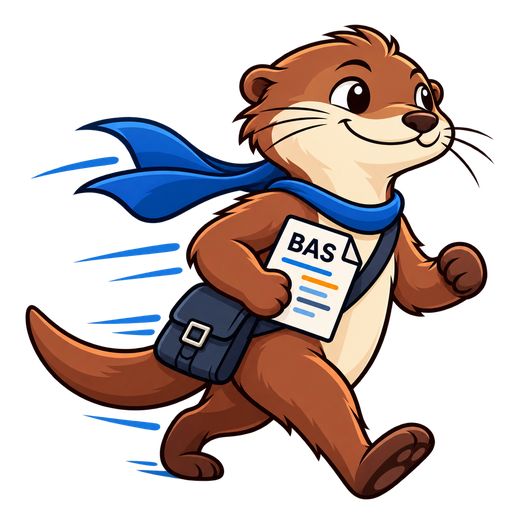

<p align="center">
  
</p>

<h1 align="center">Vambas-vai</h1>

<p align="center">
  <em>¡Vamos, básico! -- vai!</em><br>
  <em>A language server and compiler intended to maintain VB6/VBA compatibility</em>
</p>

> [!WARNING]
> **This project is still early alpha and not intended for any productive use.**

Vambas-vai is a parser, binder, and checker for VB6/VBA with an initial language
server and native compiler. The architecture loosely follows
[`typescript-go`](https://github.com/microsoft/typescript-go), with VBA-specific
syntax and semantics. The front end is shared by the editor tooling and the native
compiler, which targets LLVM IR, so that LLVM can be used as a compiler backend.

The goal is maintaining ABI compatibility with VBA at module boundaries on Windows
while ensuring portability. The compiler is intended to support
[Rubberduck](https://github.com/rubberduck-vba/Rubberduck) tests natively.

```text
.bas/.cls/.vbp ─► parser ─► binder ─► checker ─┬─► language server (LSP)
                                               │
                                               └─► typed semantic IR ─► LLVM IR ─► Clang ─► native code
```

## Status

What works today, on 64-bit Linux:

- **Language server:** diagnostics, hover, go to definition, document symbols,
  semantic highlighting, and UDT member completion, with a VS Code development
  client.
- **Compiler:** standard and class modules, `Implements`, UDTs and enums,
  dynamic and fixed arrays, Strings, Variants, Collection, Date/Currency/Decimal,
  `On Error`/`Resume`/`Err`, GoSub, ParamArray, and a growing set of built-in
  functions. Unsupported constructs produce diagnostics; nothing is silently
  skipped.
- **Native test runner:** discovers Rubberduck-style test annotations and runs the
  tests as native code, without Office or COM, with JSON and JUnit reports.
- **Real-world check:** the complete, unmodified test project of
  [vba-regex](https://github.com/sihlfall/vba-regex) (316 tests) passes at `-O0`
  and `-O2`.

Windows native builds, COM interop, and the public VBA ABI are not done yet.

## Quick start

Requirements: [Go](https://go.dev/) 1.23.1 or later. Native code additionally
needs LLVM/Clang 20.

Compile a VBA project to LLVM IR, then to a native executable:

```sh
go run ./cmd/vambas-compile -root examples/array-access -entry Main.Main -o /tmp/array-access.ll
clang-20 -O2 /tmp/array-access.ll runtime/*.c -lm -o /tmp/array-access
/tmp/array-access; echo $?   # 55
```

Run a project's Rubberduck-style tests natively:

```sh
go run ./cmd/vambas-test -root examples/testing
```

Further projects are in [`examples/`](examples). To inspect the generated LLVM
IR and native assembly side by side with the VBA source, start the local
[Compiler Explorer](tools/compiler-explorer/README.md):
`tools/compiler-explorer/start.sh`.

## Components

| Command | Purpose |
| --- | --- |
| [`cmd/vambas-language-server`](lsp/README.md) | LSP server over stdio |
| [`cmd/vambas-compile`](llvm/README.md) | VBA project to textual LLVM IR, optionally with a native `main` |
| [`cmd/vambas-test`](testrunner/README.md) | Native Rubberduck-style test discovery and execution |
| [`extensions/vscode`](extensions/vscode/README.md) | VS Code development client |
| [`tools/compiler-explorer`](tools/compiler-explorer/README.md) | Local Compiler Explorer with VBA source, LLVM IR, and assembly |

Build the executables with `go build -o bin/ ./cmd/...`.

## Documentation

**Front end**

- [AST representation](ast/README.md)
- [Parser](parser/README.md), [binder](binder/README.md), and [project programs](compiler/README.md)
- [Checker](checker/README.md) and [call/storage plans](checker/CALLS.md)
- [Language server architecture and supported features](lsp/README.md)

**Compiler**

- [LLVM compiler design](VBA_LLVM_Compiler_Design.md)
- [Typed semantic IR, lowering API, and compiler subset](ir/README.md)
- [Identity retention analysis](ir/identity/README.md)
- [LLVM backend and native example](llvm/README.md)
- [Arrays, direct element access, and lock elision](llvm/ARRAYS.md)
- [Error handling](llvm/ERROR_HANDLING.md), [GoSub/Return](llvm/GOSUB.md), and [control flow](llvm/CONTROL_FLOW.md)
- [Strings](llvm/STRINGS.md), [Variants](llvm/VARIANT.md), and [ParamArray](llvm/PARAMARRAY.md)
- [Classes](llvm/CLASSES.md), [Implements](llvm/IMPLEMENTS.md), and [Collection](llvm/COLLECTION.md)

**Testing**

- [Native Rubberduck-style tests](testrunner/README.md) and [test design](VBA_LLVM_Test_Design.md)

## Development

Run all tests:

```sh
go test -timeout 60m ./...
```

The native backend tests use the LLVM 20 tools `clang`, `opt`, `lli`, `llc`,
`llvm-as`, and `llvm-link` (with or without a `-20` suffix) and take about
20 minutes. Without the tools, those tests are skipped; set
`VBA_LLVM_TEST_REQUIRED=1` to make that an error instead. Everything else runs
in under a minute.

## License

[MIT](LICENSE)
